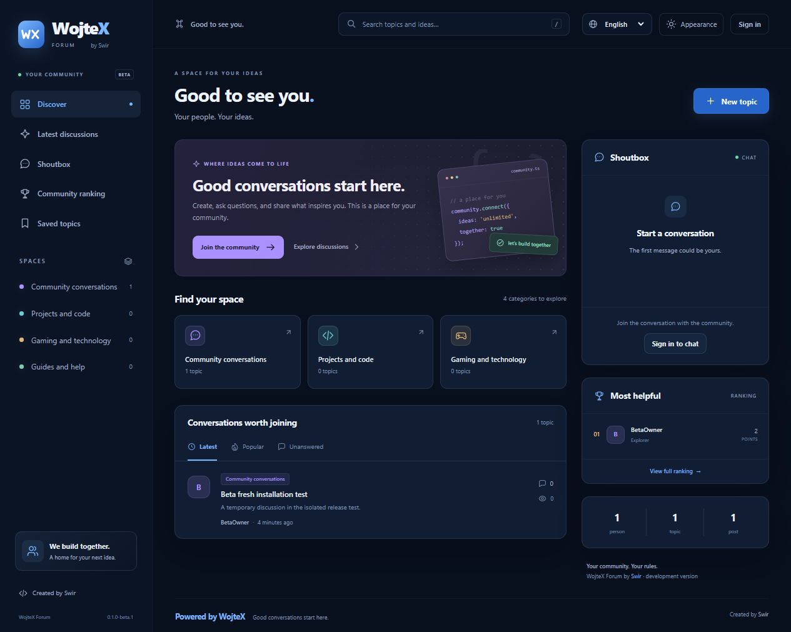
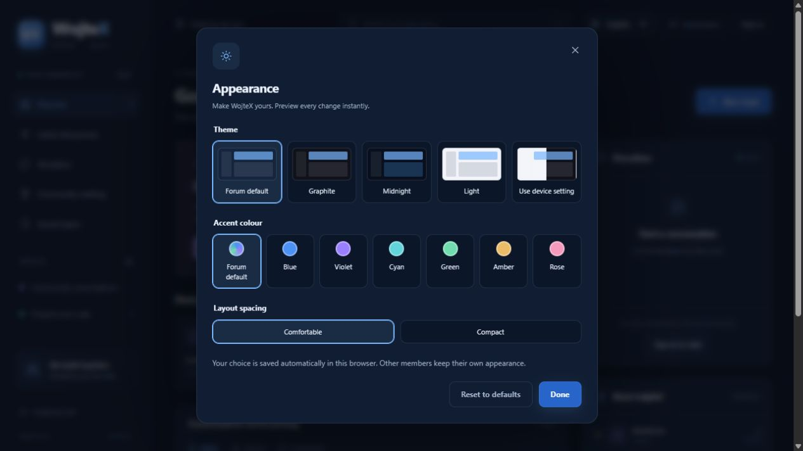

# WojteX Forum

**0.1.0-beta.1 · pierwsze publiczne wydanie testowe · by Swir**

Samodzielnie hostowane forum z polskim i angielskim interfejsem, panelem administracji i wyborem wyglądu dla każdego odwiedzającego. Projekt rozwija wcześniejszy prototyp Veyra; nazwy niektórych wewnętrznych klas i ustawień zachowano dla zgodności.



*Rzeczywisty widok beta.1 na lokalnej instalacji testowej — nocny granat z niebieskim akcentem, interfejs angielski. Forum obsługuje również język polski.*

<details>
<summary>Panel zmiany wyglądu / Appearance settings</summary>



</details>

**Beta do testów na osobnej instalacji.** To nie jest jeszcze stabilne wydanie do zastąpienia działającej społeczności. Szczegóły sprawdzonych funkcji i ograniczeń: [kontrola wydania](docs/RELEASE_CHECKS.md).

## Pobierz i zainstaluj

Pobierz **WojteX-0.1.0-beta.1-install.zip** z [Releases](https://github.com/Swir/WojteX/releases). Ta paczka zawiera zależności PHP w `vendor/` i nie wymaga budowania JavaScript. Automatyczne archiwa GitHub „Source code” zawierają kod bez zależności — po ich pobraniu trzeba wykonać `composer install`.

- [Instalacja po polsku](docs/INSTALL_PL.md)
- [Installation in English](docs/QUICKSTART_EN.md)
- [Zmiany i ograniczenia beta](docs/CHANGELOG.md)
- [Aktualizacja istniejącej kopii testowej](docs/UPGRADING.md)

## Co zawiera beta

- Kategorie, tematy, odpowiedzi, edycja, reakcje, zakładki i załączniki.
- Konta użytkowników, profile, administracja, moderacja, grupy i uprawnienia działów.
- Prywatne wiadomości, preferencje odbioru, blokady i zgłoszenia.
- Shoutbox i ranking jako włączane moduły.
- Polski i angielski oraz dodatkowe paczki językowe JSON.
- Panel **Wygląd**: grafit, nocny granat, jasny, tryb urządzenia; sześć kolorów i dwa warianty odstępów. Osobiste ustawienia są zapisywane w przeglądarce, nie na koncie.
- Instalator z kodem właściciela i opcjonalnymi danymi demonstracyjnymi.
- Eksperymentalny importer MyBB. Zakres i ograniczenia: [MYBB_IMPORT.md](docs/MYBB_IMPORT.md).

## Wymagania

PHP **8.3+** z Argon2id, rozszerzeniami `ctype`, `curl`, `dom`, `fileinfo`, `filter`, `hash`, `mbstring`, `openssl`, `pcre`, `pdo`, `session`, `tokenizer`, `xml` oraz `pdo_sqlite` albo `pdo_mysql`. Domyślna instalacja korzysta z SQLite; MySQL/MariaDB ustawia się w `.env` przed uruchomieniem instalatora. Testy PHPUnit wymagają dodatkowo `xmlwriter` i SQLite.

Katalogiem publicznym serwera musi być **`public/`**. Pliki `.env`, `vendor/`, `storage/` i baza nie mogą być dostępne przez WWW. Nie wgrywaj całego projektu do publicznego katalogu strony bez odpowiedniego rozdzielenia.

## Praca nad kodem

```sh
composer install
php vendor/bin/phpunit --no-progress
node tests/appearance.mjs
python tools/verify_source.py
```

Testy należy uruchamiać w osobnej kopii, bez konfiguracji i bazy czynnego forum. [Dokumentacja dla twórców](docs/DEVELOPMENT.md) opisuje budowanie paczki.

Kod projektu: MIT, © 2026 Swir. Zależności mają własne licencje — patrz [THIRD_PARTY_NOTICES.md](THIRD_PARTY_NOTICES.md).

---

**English:** WojteX is a self-hosted community forum with Polish/English interfaces, administration, private messages, modular shoutbox/rankings and personal appearance preferences. This is a **testing pre-release**, not a production migration recommendation. Download the `install.zip` release asset for bundled PHP dependencies; GitHub source archives require Composer. Start with the [English installation guide](docs/QUICKSTART_EN.md).
